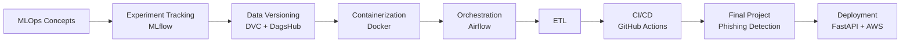
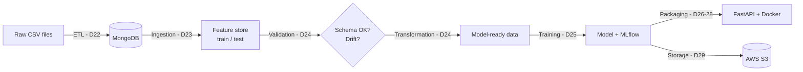

# #30DaysOfMLOpsCode

A 30-day hands-on journey through MLOps: experiment tracking, data versioning, containerization, orchestration, CI/CD and an end-to-end production project.


---

## Table of Contents

- [Overview](#overview)
- [Challenge Roadmap](#challenge-roadmap)
- [Day-by-Day Breakdown](#day-by-day-breakdown)
  - [Week 1 — Fundamentals, MLflow & DVC](#week-1--fundamentals-mlflow--dvc-days-1-to-7)
  - [Week 2 — Design Patterns, Docker & Airflow](#week-2--design-patterns-docker--airflow-days-8-to-14)
  - [Week 3 — ETL & CI/CD](#week-3--etl--cicd-days-15-to-20)
  - [Week 4+ — Final Project: Phishing URL Detection](#week-4--final-project-phishing-url-detection-days-21-to-29)
- [My Publications](#my-publications)
- [Related Repositories](#related-repositories)
- [External Resources Used](#external-resources-used)

---

## Overview

This repository gathers the code, screenshots and notes produced during my **#30DaysOfMLOpsCode** challenge. Each `day X` folder corresponds to one day (or a block of days) and contains either code or a README summarizing what I learned, with links to my posts and to the dedicated repositories.

The challenge follows the logical progression of a Machine Learning model's lifecycle:



---

## Challenge Roadmap

| Day | Topic | Tools | Deliverable |
|:---:|---|---|---|
| 1 | Introduction to MLOps | — | [Medium article](https://hermanmotcheyo.medium.com/mlops-explained-a-deep-dive-into-machine-learning-operations-ab9342c5c90d) |
| 2 | Data versioning | DVC | [`day 2/`](./day%202/) |
| 3 | Getting started with MLflow | MLflow, Transformers | [`day 3/`](./day%203/) |
| 4 | Experiment tracking & tuning | MLflow, scikit-learn | [Notebook](./day%204/housepricepredict.ipynb) |
| 5 – 6 | End-to-end ML pipeline | DVC, MLflow, DagsHub | [GitHub](https://github.com/Herman-Motcheyo/ML-pipeline-with-DVC-Dagshub-Mlflow) · [DagsHub](https://dagshub.com/Herman-Motcheyo/End-o-end-ML-project-with-DVC-Dagshub-Mlflow) |
| 7 | Design patterns (theory) | Python | [LinkedIn post](https://www.linkedin.com/posts/herman-tcheneghon-motcheyo-8b95a7180_30daysofmlopscode-mlops-machinelearning-activity-7315945720912502784-OLGj) |
| 8 | Design patterns (practice) | Python | [Design-pattern repo](https://github.com/Herman-Motcheyo/Design-pattern) |
| 9 – 10 | Docker for MLOps | Docker | [LinkedIn post](https://www.linkedin.com/posts/herman-tcheneghon-motcheyo-8b95a7180_30daysofmlopscode-docker-mlops-activity-7317287533405495296-lnOX) |
| 11 | Containerized ML project | Docker, DVC, Streamlit, DagsHub | [DagsHub](https://dagshub.com/Herman-Motcheyo/ML-Project-Docker) |
| 12 | Introduction to Apache Airflow | Airflow | [LinkedIn post](https://www.linkedin.com/posts/herman-tcheneghon-motcheyo-8b95a7180_30daysofmlopscode-airflow-mlops-activity-7318746846191906816-f0Pw) |
| 13 – 14 | First DAGs, XComs, TaskFlow API | Airflow, Astronomer | [GitHub](https://github.com/Herman-Motcheyo/First-DAG-with-Apache-Airflow) |
| 15 | ETL concepts | — | [LinkedIn post](https://www.linkedin.com/posts/herman-tcheneghon-motcheyo-8b95a7180_30daysofmlopscode-mlops-etl-activity-7319797007731077121-SON2) |
| 16 | Weather ETL pipeline | Airflow, PostgreSQL, Node.js, Flutter | [`day 16/`](./day%2016/) |
| 17 | Introduction to CI/CD | — | [LinkedIn post](https://www.linkedin.com/posts/herman-tcheneghon-motcheyo-8b95a7180_30daysofmlopscode-devops-mlops-activity-7321664802701938689-7zx5) |
| 18 | CI/CD tools | GitHub Actions | [LinkedIn post](https://www.linkedin.com/posts/herman-tcheneghon-motcheyo-8b95a7180_30daysofmlopscode-github-actions-activity-7322343004952825856-X2Ft) |
| 19 | First CI/CD project | Flask, Docker, GitHub Actions | [LinkedIn post](https://www.linkedin.com/posts/herman-tcheneghon-motcheyo-8b95a7180_30daysofmlopscode-mlops-30daysofmlops-activity-7322853626245185537-YCjK) |
| 20 | Final projects announcement | — | [LinkedIn post](https://www.linkedin.com/posts/herman-tcheneghon-motcheyo-8b95a7180_30daysofmlopscode-30daysofmlops-mlops-activity-7323203141724786688-nACO) |
| 21 | Phishing — project setup | DVC, MongoDB, logging | [`day 21/`](./day%2021/) |
| 22 | Phishing — ETL & exceptions | MongoDB, Python | [`day 22/`](./day%2022/) |
| 23 | Phishing — data ingestion | MongoDB, pandas | [LinkedIn post](https://www.linkedin.com/posts/herman-tcheneghon-motcheyo-8b95a7180_30daysofmlopscode-mlops-dataengineering-activity-7324722540344393728-jL52) |
| 24 | Phishing — validation & transformation | Evidently AI | [LinkedIn post](https://www.linkedin.com/posts/herman-tcheneghon-motcheyo-8b95a7180_30daysofmlopscode-mlops-dataengineering-activity-7325413204694638592-yyT7) |
| 25 | Phishing — training & evaluation | scikit-learn, MLflow | [LinkedIn post](https://www.linkedin.com/posts/herman-tcheneghon-motcheyo-8b95a7180_30daysofmlopscode-mlops-dataengineering-activity-7326063878272868352-EWTT) |
| 26 – 28 | Phishing — packaging & deployment | FastAPI, Docker | [LinkedIn post](https://www.linkedin.com/posts/herman-tcheneghon-motcheyo-8b95a7180_30daysofmlopscode-mlops-fastapi-activity-7326772662997835776-KA3-) |
| 29 | Cloud | AWS S3 | [LinkedIn post](https://www.linkedin.com/posts/herman-tcheneghon-motcheyo-8b95a7180_30daysofmlopscode-aws-s3-activity-7327063635913039872-TCBz) |

---

## Day-by-Day Breakdown

### Week 1 — Fundamentals, MLflow & DVC (days 1 to 7)

#### Day 1 — Understanding MLOps
I studied the core concepts of MLOps (model lifecycle, differences with DevOps, maturity levels, roles) and turned them into a summary article.

- **My article:** [MLOps Explained: A Deep Dive into Machine Learning Operations](https://hermanmotcheyo.medium.com/mlops-explained-a-deep-dive-into-machine-learning-operations-ab9342c5c90d) (Medium)

#### Day 2 — Data Versioning with DVC
Initialized **DVC** in the repository, tracked a `data/` folder through `data.dvc`, and configured a local remote (`local_remote/`) that stores data versions by MD5 hash.

```bash
dvc init
dvc add data
dvc remote add -d local_remote ./local_remote
dvc push
```

- Code: [`day 2/`](./day%202/)
- Resources: [DVC Documentation](https://dvc.org/doc) · [My article — Data Version Control (DVC) for Machine Learning](https://hermanmotcheyo.medium.com/data-version-control-dvc-for-machine-learning-how-to-version-your-data-like-code-93418c950aae)

#### Day 3 — Getting Started with MLflow
Hands-on introduction to MLflow through the official text generation tutorial with Hugging Face Transformers.

- Resource used: [MLflow — Tutorial: Text Generation with Transformers](https://mlflow.org/docs/latest/llms/transformers/tutorials/text-generation/text-generation)
- Documentation: [MLflow Docs](https://mlflow.org/docs/latest/index.html)

#### Day 4 — Experiment Tracking & Hyperparameter Tuning with MLflow
House price prediction on the **California Housing** dataset:

- Hyperparameter tuning with `GridSearchCV` across 6 models (RandomForest, GradientBoosting, Ridge, Lasso, DecisionTree, SVR)
- Logging parameters and metrics (`mlflow.log_param`, `mlflow.log_metric`) and models (`mlflow.sklearn.log_model` with `infer_signature`)
- Comparing runs in the MLflow UI and registering the best model
- Best tracked RandomForest run: `n_estimators=200`, `max_depth=None`, `min_samples_split=2`, `min_samples_leaf=1` → **MSE ≈ 0.256**

```bash
mlflow ui   # then open http://127.0.0.1:5000
```

- Code: [`day 4/housepricepredict.ipynb`](./day%204/housepricepredict.ipynb) · screenshots in [`day 4/capture/`](./day%204/capture/)
- Resources: [MLflow Tracking](https://mlflow.org/docs/latest/tracking.html) · [MLflow Model Registry](https://mlflow.org/docs/latest/model-registry.html) · [California Housing — scikit-learn](https://scikit-learn.org/stable/modules/generated/sklearn.datasets.fetch_california_housing.html) · [GridSearchCV](https://scikit-learn.org/stable/modules/generated/sklearn.model_selection.GridSearchCV.html)

#### Days 5 & 6 — End-to-End ML Pipeline with DVC, MLflow and DagsHub
Diabetes prediction pipeline (**Pima Indians Diabetes**) using a `RandomForestClassifier`, split into three reproducible DVC stages:

| Stage | Script | Input → Output |
|---|---|---|
| Preprocessing | `preprocess.py` | `data/raw/data.csv` → `data/processed/data.csv` |
| Training | `train.py` | processed data → `models/random_forest.pkl` (hyperparameters in `params.yaml`) |
| Evaluation | `evaluate.py` | model → accuracy & classification report logged to MLflow |

Data, models and experiments are hosted on **DagsHub** (DVC remote + MLflow server).

- **Code:** [GitHub — ML-pipeline-with-DVC-Dagshub-Mlflow](https://github.com/Herman-Motcheyo/ML-pipeline-with-DVC-Dagshub-Mlflow)
- **Experiments:** [DagsHub — End-to-end ML project](https://dagshub.com/Herman-Motcheyo/End-o-end-ML-project-with-DVC-Dagshub-Mlflow)
- Details: [`day 5 - 6/README.MD`](./day%205%20-%206/README.MD)
- Resources: [DVC Pipelines](https://dvc.org/doc/start/data-pipelines/data-pipelines) · [DagsHub Docs](https://dagshub.com/docs/) · [DagsHub + MLflow](https://dagshub.com/docs/integration_guide/mlflow_tracking/) · [Pima Indians Diabetes Dataset (Kaggle)](https://www.kaggle.com/datasets/uciml/pima-indians-diabetes-database)

#### Day 7 — Design Patterns for MLOps (Theory)
Why design patterns make ML code more modular, testable and maintainable.

- **My post:** [LinkedIn — Design patterns & MLOps](https://www.linkedin.com/posts/herman-tcheneghon-motcheyo-8b95a7180_30daysofmlopscode-mlops-machinelearning-activity-7315945720912502784-OLGj)
- Resource: [Refactoring.Guru — Design Patterns](https://refactoring.guru/design-patterns)

---

### Week 2 — Design Patterns, Docker & Airflow (days 8 to 14)

#### Day 8 — Design Patterns in Python (Practice)
Implementation of three patterns commonly used in Data Science and MLOps:

| Pattern | Type | Use case | Code |
|---|---|---|---|
| **Factory** | Creational | Centralize object creation (e.g. instantiate a model from a config) | [Factory](https://github.com/Herman-Motcheyo/Design-pattern/tree/main/Factory) |
| **Strategy** | Behavioral | Select an algorithm at runtime without modifying the class | [Strategy](https://github.com/Herman-Motcheyo/Design-pattern/tree/main/Strategy) |
| **Template Method** | Behavioral | Define a pipeline skeleton; subclasses implement the steps | [Template](https://github.com/Herman-Motcheyo/Design-pattern/tree/main/Template) |

- **Code:** [GitHub — Design-pattern](https://github.com/Herman-Motcheyo/Design-pattern)
- Resources: [Factory Method](https://refactoring.guru/design-patterns/factory-method) · [Strategy](https://refactoring.guru/design-patterns/strategy) · [Template Method](https://refactoring.guru/design-patterns/template-method)

#### Days 9 & 10 — Docker for MLOps
Images, containers, Dockerfiles, volumes and networks: why Docker guarantees reproducible ML environments.

- **My post:** [LinkedIn — Docker & MLOps](https://www.linkedin.com/posts/herman-tcheneghon-motcheyo-8b95a7180_30daysofmlopscode-docker-mlops-activity-7317287533405495296-lnOX)
- Resources: [Docker Docs](https://docs.docker.com/) · [Docker — Get started](https://docs.docker.com/get-started/) · [Dockerfile reference](https://docs.docker.com/reference/dockerfile/)

#### Day 11 — Containerized ML Project (Docker + DVC + Streamlit)
Complete pipeline on the **Wine** dataset:

- Training a **Gradient Boosting** model, versioned with DVC (`dvc repro`)
- Batch predictions on uploaded `.csv` files
- Interactive **Streamlit** interface
- Centralized configuration in `config.yaml`
- Application packaged as a Docker image

```bash
docker build -t ml-docker-app .
docker run -p 8501:8501 ml-docker-app
```

- **Code:** [GitHub](https://github.com/Herman-Motcheyo/ML-pipeline-with-DVC-Dagshub-Mlflow) · [DagsHub — ML-Project-Docker](https://dagshub.com/Herman-Motcheyo/ML-Project-Docker)
- Details: [`day 11/Readme.MD`](./day%2011/Readme.MD)
- Resources: [Streamlit Docs](https://docs.streamlit.io/) · [Deploy Streamlit with Docker](https://docs.streamlit.io/deploy/tutorials/docker) · [`dvc stage add`](https://dvc.org/doc/command-reference/stage/add) · [Wine dataset — scikit-learn](https://scikit-learn.org/stable/modules/generated/sklearn.datasets.load_wine.html)

#### Day 12 — Introduction to Apache Airflow
Orchestration concepts: DAGs, tasks, operators, scheduler, webserver, executor.

- **My post:** [LinkedIn — Apache Airflow](https://www.linkedin.com/posts/herman-tcheneghon-motcheyo-8b95a7180_30daysofmlopscode-airflow-mlops-activity-7318746846191906816-f0Pw)
- Resources: [Apache Airflow Docs](https://airflow.apache.org/docs/apache-airflow/stable/index.html) · [Airflow — Core Concepts](https://airflow.apache.org/docs/apache-airflow/stable/core-concepts/index.html)

#### Days 13 & 14 — First DAGs with Airflow and Astronomer
Project initialized with `astro dev init` and run locally with `astro dev start` (Postgres, Webserver, Scheduler and Triggerer in Docker).

| DAG | What it shows | Code |
|---|---|---|
| `first_dag.py` | Simulated ML pipeline: ingestion → preprocessing → training → evaluation → deployment using `PythonOperator` | [first_dag.py](https://github.com/Herman-Motcheyo/First-DAG-with-Apache-Airflow/blob/main/dags/first_dag.py) |
| `xcom_learning.py` | Passing data between tasks with `xcom_push` / `xcom_pull` (15 → +11 → ×2 → −5) | [xcom_learning.py](https://github.com/Herman-Motcheyo/First-DAG-with-Apache-Airflow/blob/main/dags/xcom_learning.py) |
| `taskflowapi.py` | Same pipeline rewritten with the **TaskFlow API** (`@task`) | [taskflowapi.py](https://github.com/Herman-Motcheyo/First-DAG-with-Apache-Airflow/blob/main/dags/taskflowapi.py) |

- **Code:** [GitHub — First-DAG-with-Apache-Airflow](https://github.com/Herman-Motcheyo/First-DAG-with-Apache-Airflow)
- **My post:** [LinkedIn — First Airflow DAGs](https://www.linkedin.com/posts/herman-tcheneghon-motcheyo-8b95a7180_30daysofmlopscode-airflow-mlops-activity-7319661128886718464-NPYl)
- Resources: [Astro CLI](https://www.astronomer.io/docs/astro/cli/overview) · [Astronomer — Deploy code](https://www.astronomer.io/docs/astro/deploy-code/) · [Astronomer — Troubleshoot locally](https://www.astronomer.io/docs/astro/cli/troubleshoot-locally) · [Airflow XComs](https://airflow.apache.org/docs/apache-airflow/stable/core-concepts/xcoms.html) · [Airflow TaskFlow API](https://airflow.apache.org/docs/apache-airflow/stable/tutorial/taskflow.html)

---

### Week 3 — ETL & CI/CD (days 15 to 20)

#### Day 15 — Understanding ETL Pipelines
Extract, Transform, Load: the role of ETL in feeding ML models, and the differences between ETL and ELT.

- **My post:** [LinkedIn — ETL Pipeline](https://www.linkedin.com/posts/herman-tcheneghon-motcheyo-8b95a7180_30daysofmlopscode-mlops-etl-activity-7319797007731077121-SON2)
- Resource used: [Estuary — What is an ETL Pipeline?](https://estuary.dev/blog/what-is-an-etl-pipeline/)

#### Day 16 — Weather ETL Pipeline (Airflow, PostgreSQL, Node.js, Flutter)
A real-world pipeline that collects, transforms, stores and serves weather data:

- **Extract**: `SimpleHttpOperator` queries the OpenWeather API
- **Transform**: °F → °C conversion, removal of malformed records
- **Load**: dynamic table creation and inserts through `PostgresHook`
- **Serving**: Node.js / Express REST API and a Flutter mobile app

Challenges faced: configuring `PostgresHook`, multi-service orchestration with Docker Compose, handling API errors.

- Details: [`day 16/README.MD`](./day%2016/README.MD)
- Resources: [OpenWeather API](https://openweathermap.org/api) · [Astronomer](https://www.astronomer.io/) · [Airflow HTTP provider](https://airflow.apache.org/docs/apache-airflow-providers-http/stable/index.html) · [Airflow Postgres provider](https://airflow.apache.org/docs/apache-airflow-providers-postgres/stable/index.html) · [Express](https://expressjs.com/) · [Flutter](https://docs.flutter.dev/) · [Docker Compose](https://docs.docker.com/compose/)

#### Day 17 — Introduction to CI/CD for ML
Continuous integration, continuous delivery and continuous training (CT) applied to Machine Learning.

- **My post:** [LinkedIn — Introduction to CI/CD](https://www.linkedin.com/posts/herman-tcheneghon-motcheyo-8b95a7180_30daysofmlopscode-devops-mlops-activity-7321664802701938689-7zx5)
- Resource used: [Iguazio — CI/CD for Machine Learning](https://www.iguazio.com/glossary/ci-cd-for-machine-learning/)

#### Day 18 — CI/CD Tools
Overview of the tooling landscape (GitHub Actions, GitLab CI, Jenkins, CircleCI…) with a focus on GitHub Actions: workflows, jobs, steps, runners, secrets.

- **My post:** [LinkedIn — GitHub Actions](https://www.linkedin.com/posts/herman-tcheneghon-motcheyo-8b95a7180_30daysofmlopscode-github-actions-activity-7322343004952825856-X2Ft)
- Resources: [GitHub Actions Docs](https://docs.github.com/en/actions) · [Understanding GitHub Actions](https://docs.github.com/en/actions/about-github-actions/understanding-github-actions)

#### Day 19 — First CI/CD Project with Docker and GitHub Actions
A minimal **Flask** app (port 5000), containerized with Docker, whose image is automatically built and pushed by a GitHub Actions workflow on every push.


- **My post:** [LinkedIn — First CI/CD project](https://www.linkedin.com/posts/herman-tcheneghon-motcheyo-8b95a7180_30daysofmlopscode-mlops-30daysofmlops-activity-7322853626245185537-YCjK)
- Details: [`day 19/README.md`](./day%2019/README.md)
- Resources: [Flask](https://flask.palletsprojects.com/) · [Docker — GitHub Actions](https://docs.docker.com/build/ci/github-actions/) · [docker/build-push-action](https://github.com/docker/build-push-action) · [Docker Hub](https://hub.docker.com/)

#### Day 20 — Final Stretch: Announcing the Final Projects
Presentation of the projects that bring together everything learned so far.

- **My post:** [LinkedIn — Final Stretch](https://www.linkedin.com/posts/herman-tcheneghon-motcheyo-8b95a7180_30daysofmlopscode-30daysofmlops-mlops-activity-7323203141724786688-nACO)

---

### Week 4+ — Final Project: Phishing URL Detection (days 21 to 29)

A fully automated MLOps pipeline for real-time phishing URL detection.

- **Full project description:** [Google Doc](https://docs.google.com/document/d/1tjPloGr5Cb02iBOP23sYxZSfHiuS0HaBnB0xQBEUut8/edit?tab=t.0#heading=h.hl9pf4kiorgq)
- **Dataset:** 11,430 labeled URLs, 87 features (URL structure, HTML content, third-party reputation), balanced 50% phishing / 50% legitimate — [Web page Phishing Detection Dataset (Kaggle)](https://www.kaggle.com/datasets/shashwatwork/web-page-phishing-detection-dataset)



#### Day 21 — Project Setup
- Modular architecture: `src/`, `config/`, `data/`, `artifacts/`, `analyze/`
- Data and artifact versioning with **DVC**
- Centralized logging system (`logging` module)
- **MongoDB** database initialization
- Details: [`day 21/README.MD`](./day%2021/README.MD)
- Resources: [DVC](https://dvc.org/) · [Python logging](https://docs.python.org/3/library/logging.html) · [MongoDB Docs](https://www.mongodb.com/docs/)

#### Day 22 — ETL and Custom Exception Handling
- **Extract** from multiple CSV files, **Transform** (column normalization, removal of duplicates and invalid records), **Load** into a MongoDB collection
- Custom exception framework that reports the exact file and line where an error occurred
- Details: [`day 22/README.MD`](./day%2022/README.MD)
- Resources: [PyMongo](https://pymongo.readthedocs.io/) · [Python — User-defined exceptions](https://docs.python.org/3/tutorial/errors.html#user-defined-exceptions)

#### Day 23 — Data Ingestion Pipeline
- Secure MongoDB connection via environment variables (`MONGO_URI`, `DB_NAME`, `COLLECTION_NAME`)
- Conversion to a `DataFrame` and cleaning (`"na"` strings, irrelevant columns)
- Storage in a `feature_store/`, then a configurable train/test split into `ingested_data/`
- An artifact file (YAML/JSON) generated on every run to trace data paths
- **My post:** [LinkedIn — Data Ingestion](https://www.linkedin.com/posts/herman-tcheneghon-motcheyo-8b95a7180_30daysofmlopscode-mlops-dataengineering-activity-7324722540344393728-jL52)
- Resources: [python-dotenv](https://pypi.org/project/python-dotenv/) · [pandas](https://pandas.pydata.org/docs/)

#### Day 24 — Data Validation and Transformation
- **Validation**: schema compliance (column names and types), missing or unexpected values, **data drift** detection between train and test sets, HTML report with **Evidently AI** (validation continues even if report generation fails)
- **Transformation**: cleaning, feature engineering on URL components, encoding, artifact tracking
- **My post:** [LinkedIn — Validation & Transformation](https://www.linkedin.com/posts/herman-tcheneghon-motcheyo-8b95a7180_30daysofmlopscode-mlops-dataengineering-activity-7325413204694638592-yyT7)
- Resources: [Evidently AI Docs](https://docs.evidentlyai.com/) · [scipy.stats.ks_2samp](https://docs.scipy.org/doc/scipy/reference/generated/scipy.stats.ks_2samp.html) · [scikit-learn Preprocessing](https://scikit-learn.org/stable/modules/preprocessing.html)

#### Day 25 — Model Training and Evaluation
Training and comparing several classification models, tracking metrics and selecting the best model.

- **My post:** [LinkedIn — Model training & evaluation](https://www.linkedin.com/posts/herman-tcheneghon-motcheyo-8b95a7180_30daysofmlopscode-mlops-dataengineering-activity-7326063878272868352-EWTT)
- Resources: [scikit-learn — Model evaluation](https://scikit-learn.org/stable/modules/model_evaluation.html) · [MLflow Tracking](https://mlflow.org/docs/latest/tracking.html)

#### Days 26 to 28 — Model Packaging and Deployment
Serving the model through a **FastAPI** API and containerizing it for deployment.

- **My post:** [LinkedIn — Deployment with FastAPI](https://www.linkedin.com/posts/herman-tcheneghon-motcheyo-8b95a7180_30daysofmlopscode-mlops-fastapi-activity-7326772662997835776-KA3-)
- Resources: [FastAPI Docs](https://fastapi.tiangolo.com/) · [FastAPI in Containers — Docker](https://fastapi.tiangolo.com/deployment/docker/) · [Uvicorn](https://www.uvicorn.org/)

#### Day 29 — AWS
Storing artifacts and models in **Amazon S3**.

- **My post:** [LinkedIn — AWS S3](https://www.linkedin.com/posts/herman-tcheneghon-motcheyo-8b95a7180_30daysofmlopscode-aws-s3-activity-7327063635913039872-TCBz)

---

## My Publications

Everything I wrote during the challenge:

| Day | Topic | Link |
|:---:|---|---|
| 1 | MLOps Explained: A Deep Dive into Machine Learning Operations | [Medium](https://hermanmotcheyo.medium.com/mlops-explained-a-deep-dive-into-machine-learning-operations-ab9342c5c90d) |
| 7 | Design patterns for MLOps | [LinkedIn](https://www.linkedin.com/posts/herman-tcheneghon-motcheyo-8b95a7180_30daysofmlopscode-mlops-machinelearning-activity-7315945720912502784-OLGj) |
| 9 – 10 | Docker for MLOps | [LinkedIn](https://www.linkedin.com/posts/herman-tcheneghon-motcheyo-8b95a7180_30daysofmlopscode-docker-mlops-activity-7317287533405495296-lnOX) |
| 12 | Introduction to Apache Airflow | [LinkedIn](https://www.linkedin.com/posts/herman-tcheneghon-motcheyo-8b95a7180_30daysofmlopscode-airflow-mlops-activity-7318746846191906816-f0Pw) |
| 14 | First Airflow DAGs | [LinkedIn](https://www.linkedin.com/posts/herman-tcheneghon-motcheyo-8b95a7180_30daysofmlopscode-airflow-mlops-activity-7319661128886718464-NPYl) |
| 15 | ETL pipelines | [LinkedIn](https://www.linkedin.com/posts/herman-tcheneghon-motcheyo-8b95a7180_30daysofmlopscode-mlops-etl-activity-7319797007731077121-SON2) |
| 17 | Introduction to CI/CD | [LinkedIn](https://www.linkedin.com/posts/herman-tcheneghon-motcheyo-8b95a7180_30daysofmlopscode-devops-mlops-activity-7321664802701938689-7zx5) |
| 18 | GitHub Actions | [LinkedIn](https://www.linkedin.com/posts/herman-tcheneghon-motcheyo-8b95a7180_30daysofmlopscode-github-actions-activity-7322343004952825856-X2Ft) |
| 19 | First CI/CD project | [LinkedIn](https://www.linkedin.com/posts/herman-tcheneghon-motcheyo-8b95a7180_30daysofmlopscode-mlops-30daysofmlops-activity-7322853626245185537-YCjK) |
| 20 | Final Stretch: 3 MLOps projects | [LinkedIn](https://www.linkedin.com/posts/herman-tcheneghon-motcheyo-8b95a7180_30daysofmlopscode-30daysofmlops-mlops-activity-7323203141724786688-nACO) |
| 23 | Data ingestion | [LinkedIn](https://www.linkedin.com/posts/herman-tcheneghon-motcheyo-8b95a7180_30daysofmlopscode-mlops-dataengineering-activity-7324722540344393728-jL52) |
| 24 | Data validation & transformation | [LinkedIn](https://www.linkedin.com/posts/herman-tcheneghon-motcheyo-8b95a7180_30daysofmlopscode-mlops-dataengineering-activity-7325413204694638592-yyT7) |
| 25 | Model training & evaluation | [LinkedIn](https://www.linkedin.com/posts/herman-tcheneghon-motcheyo-8b95a7180_30daysofmlopscode-mlops-dataengineering-activity-7326063878272868352-EWTT) |
| 26 – 28 | Deployment with FastAPI | [LinkedIn](https://www.linkedin.com/posts/herman-tcheneghon-motcheyo-8b95a7180_30daysofmlopscode-mlops-fastapi-activity-7326772662997835776-KA3-) |
| 29 | AWS S3 | [LinkedIn](https://www.linkedin.com/posts/herman-tcheneghon-motcheyo-8b95a7180_30daysofmlopscode-aws-s3-activity-7327063635913039872-TCBz) |

---

## Related Repositories

| Project | GitHub | DagsHub |
|---|---|---|
| ML pipeline with DVC, DagsHub & MLflow (D5-6) | [ML-pipeline-with-DVC-Dagshub-Mlflow](https://github.com/Herman-Motcheyo/ML-pipeline-with-DVC-Dagshub-Mlflow) | [End-o-end-ML-project-with-DVC-Dagshub-Mlflow](https://dagshub.com/Herman-Motcheyo/End-o-end-ML-project-with-DVC-Dagshub-Mlflow) |
| Design patterns in Python (D8) | [Design-pattern](https://github.com/Herman-Motcheyo/Design-pattern) | — |
| ML project with Docker (D11) | — | [ML-Project-Docker](https://dagshub.com/Herman-Motcheyo/ML-Project-Docker) |
| First Airflow DAGs (D13-14) | [First-DAG-with-Apache-Airflow](https://github.com/Herman-Motcheyo/First-DAG-with-Apache-Airflow) | — |

---

## External Resources Used

### Articles and Tutorials
- [MLflow — Tutorial: Text Generation with Transformers](https://mlflow.org/docs/latest/llms/transformers/tutorials/text-generation/text-generation) (D3)
- [Estuary — What is an ETL Pipeline?](https://estuary.dev/blog/what-is-an-etl-pipeline/) (D15)
- [Iguazio — CI/CD for Machine Learning](https://www.iguazio.com/glossary/ci-cd-for-machine-learning/) (D17)
- [Refactoring.Guru — Design Patterns](https://refactoring.guru/design-patterns) (D7-8)

### Official Documentation by Tool

| Area | Tool | Documentation |
|---|---|---|
| Experiment tracking | MLflow | [mlflow.org/docs](https://mlflow.org/docs/latest/index.html) |
| Data versioning | DVC | [dvc.org/doc](https://dvc.org/doc) |
| Data / experiment hosting | DagsHub | [dagshub.com/docs](https://dagshub.com/docs/) |
| Containerization | Docker | [docs.docker.com](https://docs.docker.com/) |
| Orchestration | Apache Airflow | [airflow.apache.org/docs](https://airflow.apache.org/docs/apache-airflow/stable/index.html) |
| Managed Airflow / CLI | Astronomer | [astronomer.io/docs](https://www.astronomer.io/docs/) |
| CI/CD | GitHub Actions | [docs.github.com/actions](https://docs.github.com/en/actions) |
| ML interface | Streamlit | [docs.streamlit.io](https://docs.streamlit.io/) |
| Web API | Flask | [flask.palletsprojects.com](https://flask.palletsprojects.com/) |
| Model serving API | FastAPI | [fastapi.tiangolo.com](https://fastapi.tiangolo.com/) |
| NoSQL database | MongoDB | [mongodb.com/docs](https://www.mongodb.com/docs/) |
| SQL database | PostgreSQL | [postgresql.org/docs](https://www.postgresql.org/docs/) |
| Monitoring / drift | Evidently AI | [docs.evidentlyai.com](https://docs.evidentlyai.com/) |
| Machine Learning | scikit-learn | [scikit-learn.org](https://scikit-learn.org/stable/) |
| Cloud | AWS S3 | [docs.aws.amazon.com/s3](https://docs.aws.amazon.com/AmazonS3/latest/userguide/Welcome.html) |
| External data | OpenWeather API | [openweathermap.org/api](https://openweathermap.org/api) |

---

`#30DaysOfMLOpsCode` `#MLOps` `#MachineLearning` `#DataEngineering`
